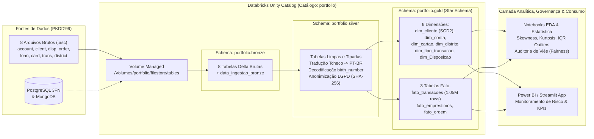

# Business Case, Arquitetura e Catálogo de KPIs — Banco Berka (PKDD'99)

## 1. Contexto Executivo e Problema de Negócio

O **Banco Berka** (instituição financeira da República Tcheca com dados operacionais entre $1993$ e $1998$, tendo como data-base de corte `1998-12-31`) busca modernizar sua infraestrutura analítica para expandir a oferta de produtos de crédito sem elevar o risco de inadimplência.

Atualmente, a instituição enfrenta dois desafios centrais de negócio:
1. **Gestão de Risco de Crédito (Empréstimos):** Necessidade de distinguir precocemente os clientes adimplentes (contratos com status `A` e `C`) dos clientes inadimplentes (contratos com status `B` e `D`), cruzando o histórico de movimentações financeiras (`trans`), ordens permanentes (`order`) e indicadores socioeconômicos regionais (`district`).
2. **Baixa Penetração de Cartões de Crédito (Cross-Selling):** Apenas uma fração das $4.500$ contas bancárias possui cartões de crédito vinculados (`classic`, `junior` ou `gold`). A diretoria precisa identificar quais titulares (`OWNER`) apresentam comportamento transacional e saldo médio compatíveis com a oferta de novos cartões, garantindo ausência de viés demográfico (gênero e idade) na concessão.

---

## 2. Objetivos Estratégicos (OKRs)

* **Objetivo 1:** Reduzir a exposição ao risco de inadimplência na carteira de empréstimos bancários.
  * *KR 1.1:* Mapear $100\%$ dos empréstimos com anomalias estatísticas (outliers via Intervalo Interquartil — IQR) e correlacioná-los com a taxa de desemprego e criminalidade do distrito.
  * *KR 1.2:* Estabelecer um motor de escoragem analítica capaz de segregar perfis de risco antes da aprovação de novos contratos.
* **Objetivo 2:** Aumentar a rentabilidade da base ativa por meio da oferta direcionada de cartões de crédito.
  * *KR 2.1:* Identificar contas elegíveis para upgrade de cartão (`classic` $\rightarrow$ `gold`) com base no fluxo de caixa líquido e estabilidade de saldo.
  * *KR 2.2:* Auditar estatisticamente a concessão de cartões e empréstimos para assegurar conformidade com a LGPD e equidade entre gêneros e faixas etárias.

---

## 3. Catálogo de Indicadores-Chave de Desempenho (KPIs)

### 3.1. KPIs de Risco e Crédito (`fato_emprestimos`)

1. **Taxa de Inadimplência da Carteira (Default Rate):**
   Mede a proporção de contratos finalizados ou em andamento que apresentaram atraso/calote (Status `B` e `D`) em relação ao total de empréstimos concedidos ($N = 682$).
   $$\text{Default Rate} = \left( \frac{\sum \text{Contratos Status } B + \sum \text{Contratos Status } D}{\text{Total de Contratos de Empréstimo}} \right) \times 100$$

2. **Exposição Financeira em Risco (Volume Inadimplente):**
   Soma do montante total concedido (`valor_emprestimo`) alocado em contratos classificados como inadimplentes:
   $$\text{Exposição em Risco} = \sum_{i \in \{B, D\}} \text{Valor do Empréstimo}_i$$

3. **Índice de Comprometimento Regional de Renda:**
   Razão entre o valor da parcela mensal do empréstimo (`valor_pagamento_mensal`) e o salário médio do distrito do cliente (`salario_medio` / `A11`):
   $$\text{Comprometimento de Renda} = \left( \frac{\text{Pagamento Mensal do Empréstimo}}{\text{Salário Médio do Distrito}} \right) \times 100$$

### 3.2. KPIs Comerciais e Comportamento Transacional (`fato_transacoes` e `dim_cartao`)

4. **Volume Financeiro Transacionado (TPV — Total Payment Volume):**
   Soma movimentada nas $1.056.320$ transações registradas na camada Gold, segmentada por tipo de operação (Crédito vs. Débito/Saque).
   $$\text{TPV} = \sum_{t=1}^{N} \text{Valor da Transação}_t$$

5. **Taxa de Penetração de Cartões (Card Attach Rate):**
   Percentual de titulares/disponentes elegíveis que possuem cartão de crédito ativo:
   $$\text{Card Attach Rate} = \left( \frac{\text{Total de Cartões Emitidos}}{\text{Total de Disponentes Elegíveis}} \right) \times 100$$

6. **Coeficiente de Variação Transacional ($\text{CV}$):**
   Mede a volatilidade das movimentações financeiras de uma conta ou tipo de transação a partir da razão entre o desvio padrão amostral ($s$) e a média ($\bar{x}$):
   $$\text{CV} = \left( \frac{s}{\bar{x}} \right) \times 100$$

---

## 4. Arquitetura da Plataforma de Dados (Lakehouse)

> **Dica para o Portfólio:** Você pode renderizar o diagrama Mermaid abaixo no [Mermaid Live Editor](https://mermaid.live/) e exportá-lo diretamente como `docs/architecture_diagram.png`.

